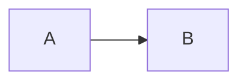

# Getting Started

This guide walks from a fresh clone to a deployed docs site in about ten
minutes. We assume you already have:

- **Node 22+** and **Bun 1.1+** installed (Bun is the package manager + script
  runner; Vite runs through it).
- A **Cloudflare account** with a workers subdomain enabled.
- **git** on your PATH: the build clones the GitHub-backed repos.
- A **GitHub personal access token** that can read your private docs repos,
  set as `VELLUM_GITHUB_TOKEN` (only for private repos; public repos clone
  unauthenticated).

::: tip Use what's already in the box
The default `vellum.config.json` in the repo wires up two real SiiWay projects
(`siiway/prism`, `siiway/glint`) plus this local handbook. You can build the
site from that config with no edits and play with the surface before plugging
in your own content.
:::

## 1. Clone and install

```bash
git clone https://github.com/siiway/vellum.git
cd vellum/app
bun install
```

## 2. Develop locally

```bash
bun run dev
```

This runs the full build (`bun run build`: the client bundle, then every
page of every repo into `dist/site`), then starts `wrangler dev` on
`http://127.0.0.1:8787`, which serves `dist/site` the way production does,
redirects and 404 pages included.

The build doesn't watch for changes. After editing, rebuild in another
terminal while `wrangler dev` keeps serving:

| You changed                             | Run                              |
| --------------------------------------- | -------------------------------- |
| React code (`src/web/`)                 | `bun run build`                  |
| Local docs, config or the renderer      | `bun run build:pages --no-fetch` |
| Nothing; you want new docs repo commits | `bun run update`                 |

`--no-fetch` reuses the repos already cloned under `.sources/` instead of
fetching them again.

## 3. Configure your repos

Open [`vellum.config.json`](./configuration) and replace the bundled examples
with your own. The minimum viable repo entry is:

# [GitHub source](#tab/github)

```json
{
  "slug": "my-docs",
  "owner": "your-github-org",
  "repo": "my-repo",
  "branch": "main",
  "docsRoot": "docs",
  "displayName": "My Docs"
}
```

The build clones `https://github.com/your-github-org/my-repo` at `main` and
renders the Markdown under `docs/`.

# [Local source](#tab/local)

```json
{
  "slug": "my-docs",
  "source": "local",
  "docsRoot": "",
  "displayName": "My Docs"
}
```

Drop `.md` files into `local-docs/my-docs/`. The build reads them from
there.

---

See [Sources](./sources) for the full comparison and other config options.

## 4. Author a page

Create `docs/index.md` (or `local-docs/my-docs/index.md`):

````md
---
title: My Docs
description: A short tagline.
---

# Welcome

This page uses **Markdown**, plus a few Vellum extras:

::: tip
Callouts work like in VitePress.
:::


````

Rebuild and reload — the page is at `/{prefix}/my-docs`, under your locale's
URL prefix (`/en-US/my-docs` with the bundled config).

## 5. Deploy

When you're ready to push to Cloudflare:

```bash
bun run deploy
```

`bun run deploy` runs the full build, then `wrangler deploy`, which uploads
`dist/site` as static assets. You'll see a
`https://vellum.<your-subdomain>.workers.dev` URL when it finishes.

::: tip Keep content current
A deploy is a snapshot of the docs repos. To pick up later commits, run
`bun run update && wrangler deploy`, or let the **Update content** workflow
do it. See [Updating content](./updating-content).
:::

## What works for which source

| Feature               | GitHub source | Local source |
| --------------------- | :-----------: | :----------: |
| Markdown render       |       ✓       |      ✓       |
| Sidebar discovery     |       ✓       |      ✓       |
| Search index          |       ✓       |      ✓       |
| OPS extensions        |       ✓       |      ✓       |
| Mermaid via Kroki     |       ✓       |      ✓       |
| Math (MathJax)        |       ✓       |      ✓       |
| xref resolution       |       ✓       |      ✓       |
| "Last updated" footer |       ✓       |      —       |
| Edit-on-GitHub button |       ✓       |      —       |
| Incremental update    |       ✓       |      —       |

Local repos skip last-updated and edit-link affordances because the build
has no history of theirs to ask, and they change with this repository, so a
deploy (not an incremental update) publishes their edits.

## Next steps

- Browse the [Configuration reference](./configuration) for every setting.
- Skim [Markdown features](./markdown) and [OPS extensions](./ops-extensions)
  to learn what your authors can write.
- See [Internationalisation](./i18n) before adding non-English content — the
  URL prefix shape is best decided up front.
