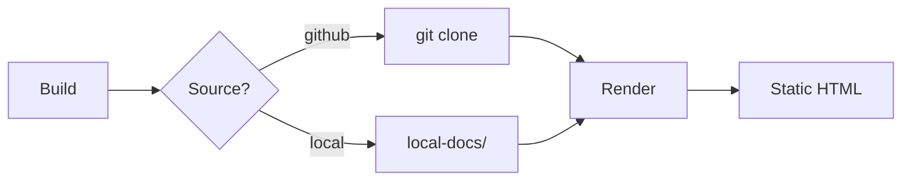
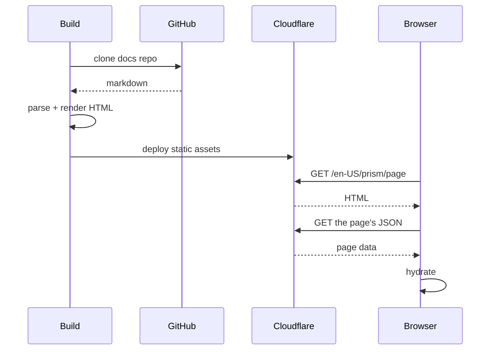
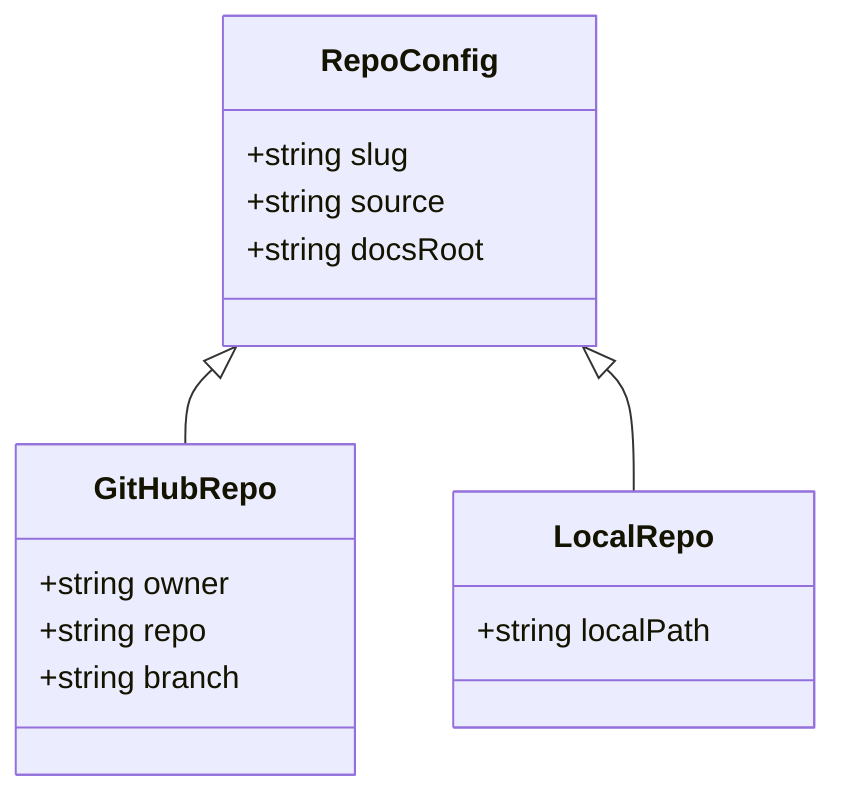
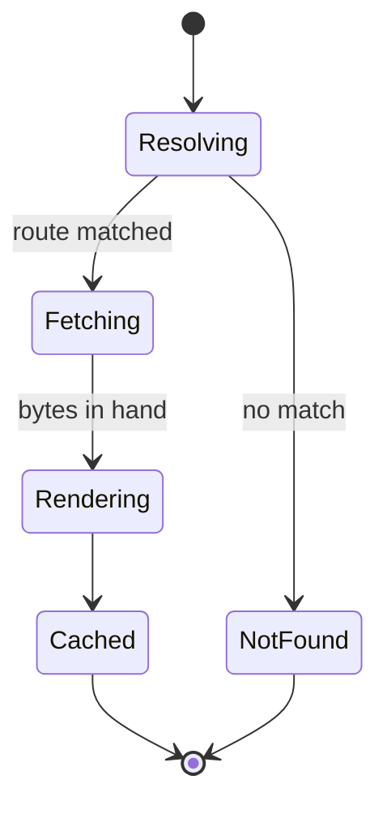
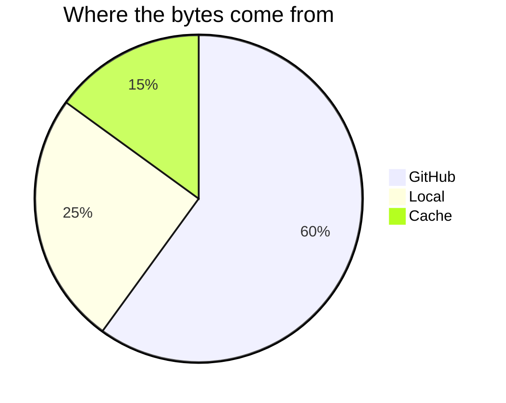
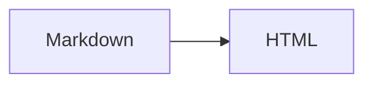

# Mermaid Diagrams

The build pre-renders each diagram against Kroki in both light and dark themes
and puts both SVGs in the page, where CSS shows the one for the theme. Toggling
the theme swaps them instantly, with no JavaScript. If Kroki was unreachable,
the client downloads the ~600KB mermaid runtime and renders client-side.

## Flowchart



## Sequence diagram



## Class diagram



## State diagram



## Pie chart



## Inside a block with code

::: details A diagram next to a code block

```sh
bun run build
```



:::
