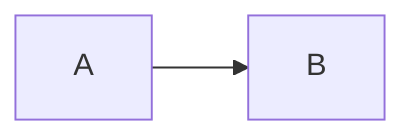

# 快速开始

本指南将带你从一次全新的 clone 开始，在大约十分钟内完成一个上线的文档站点。
我们假设你已经准备好：

- 已安装 **Node 22+** 和 **Bun 1.1+**（Bun 同时充当包管理器和脚本运行器，
  Vite 通过它运行）。
- 一个开启了 workers 子域名的 **Cloudflare 账号**。
- PATH 中可用的 **git**：构建时会克隆 GitHub 来源的仓库。
- 一个能读取你的私有文档仓库的 **GitHub 个人访问令牌**，设置为
  `VELLUM_GITHUB_TOKEN`（仅私有仓库需要；公开仓库可以匿名克隆）。

::: tip 直接使用箱内已有的内容
仓库自带的 `vellum.config.json` 已经接好了两个真实的 SiiWay 项目
（`siiway/prism`、`siiway/glint`）以及本地的这份手册。你可以直接用这份配置
构建站点，在接入自己的内容之前先把功能玩一遍。
:::

## 1. 克隆并安装

```bash
git clone https://github.com/siiway/vellum.git
cd vellum/app
bun install
```

## 2. 本地开发

```bash
bun run dev
```

这条命令会先跑完整构建（`bun run build`：先构建客户端 bundle，再把所有仓库
的每个页面渲染到 `dist/site`），然后启动 `wrangler dev` 监听
`http://127.0.0.1:8787`。它以与生产环境相同的方式提供 `dist/site`，
包括重定向和 404 页面。

构建不会监听文件变化。修改之后，在另一个终端里重新构建，`wrangler dev`
会继续提供服务：

| 你修改了                             | 运行                             |
| ------------------------------------ | -------------------------------- |
| React 代码（`src/web/`）             | `bun run build`                  |
| 本地文档、配置或渲染器               | `bun run build:pages --no-fetch` |
| 什么都没改，只想拿到文档仓库的新提交 | `bun run update`                 |

`--no-fetch` 复用已经克隆到 `.sources/` 下的仓库，不再重新拉取。还没有克隆的仓库，或因为改了 `owner` 或 `repo` 而留着另一个仓库克隆的，仍会被克隆。

## 3. 配置你的仓库

打开 [`vellum.config.json`](./configuration)，把自带的示例替换为你自己的。
一条最简的仓库配置长这样：

# [GitHub 源](#tab/github)

```json
{
  "slug": "my-docs",
  "owner": "your-github-org",
  "repo": "my-repo",
  "branch": "main",
  "docsRoot": "docs",
  "displayName": "My Docs"
}
```

构建时会克隆 `https://github.com/your-github-org/my-repo` 的 `main` 分支，
并渲染 `docs/` 下的 Markdown。

# [本地源](#tab/local)

```json
{
  "slug": "my-docs",
  "source": "local",
  "docsRoot": "",
  "displayName": "My Docs"
}
```

把 `.md` 文件放进 `local-docs/my-docs/`，构建时会从那里读取。

---

完整对比和其它配置项见 [数据源](./sources)。

## 4. 写一个页面

新建 `docs/index.md`（或 `local-docs/my-docs/index.md`）：

````md
---
title: My Docs
description: A short tagline.
---

# Welcome

This page uses **Markdown**, plus a few Vellum extras:

::: tip
Callouts work like in VitePress.
:::


````

重新构建并刷新——页面就在 `/{prefix}/my-docs`，位于语言的 URL 前缀下（自带配置下是 `/en-US/my-docs`）。

## 5. 部署

准备好推到 Cloudflare 时：

```bash
bun run deploy
```

`bun run deploy` 会先跑完整构建，再执行 `wrangler deploy`，把 `dist/site`
作为静态资源上传。结束后你会看到一个
`https://vellum.<你的-subdomain>.workers.dev` 形式的 URL。

::: tip 保持内容最新
一次部署是文档仓库的一个快照。要拿到之后的提交，运行
`bun run update && wrangler deploy`，或者交给 **Update content** 工作流。
详见 [更新内容](./updating-content)。
:::

## 各数据源支持的功能

| 功能                    | GitHub 源 | 本地源 |
| ----------------------- | :-------: | :----: |
| Markdown 渲染           |     ✓     |   ✓    |
| 侧边栏发现              |     ✓     |   ✓    |
| 搜索索引                |     ✓     |   ✓    |
| OPS 扩展                |     ✓     |   ✓    |
| 通过 Kroki 渲染 Mermaid |     ✓     |   ✓    |
| 数学公式（MathJax）     |     ✓     |   ✓    |
| xref 解析               |     ✓     |   ✓    |
| "最近更新" 页脚         |     ✓     |   —    |
| 在 GitHub 上编辑按钮    |     ✓     |   —    |
| 增量更新                |     ✓     |   —    |

本地仓库没有"最近更新"和编辑链接的功能，因为构建时没有它们自己的提交历史
可查；它们随本仓库一起变更，所以要通过部署（而不是增量更新）发布修改。

## 下一步

- 浏览 [配置参考](./configuration) 了解每一个设置项。
- 通读 [Markdown 特性](./markdown) 和 [OPS 扩展](./ops-extensions)，
  熟悉作者们能写的内容。
- 在添加非英语内容之前先看 [国际化](./i18n)——URL 前缀的形态最好在
  一开始就决定下来。
